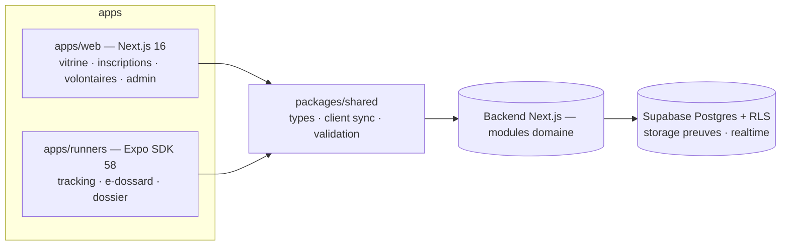
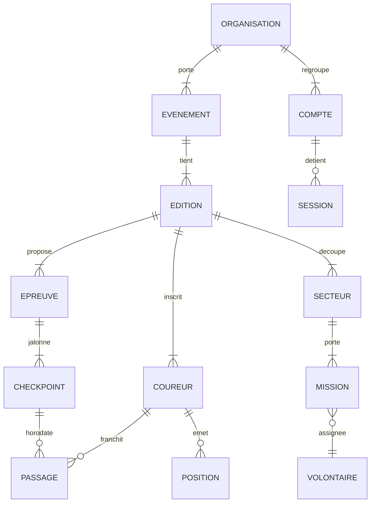

# Architecture Spine — Azzel

## Design Paradigm

**Monolithe modulaire server-authoritative, bords offline producteurs d'événements.** Un unique backend (modules Next.js par domaine) détient la vérité ; les appareils de terrain (PWA volontaires, app coureurs Expo) ne décident jamais rien : ils enregistrent des événements dans une **outbox locale append-only** et les poussent par lots idempotents quand le réseau revient. Le paradigme tient sur une phrase : *l'appareil propose, le serveur dispose.*

Cartographie modules → domaines : `inscriptions` (dossiers, décharge, preuves), `chrono` (passages, classements), `tracking` (positions), `missions` (secteurs, volontaires), `vitrine` (contenus publics, résultats live), `admin` (pilotage, rapports), `iam` (comptes, sessions, invitations).

## Invariants & Rules

### AD-1 — Plateforme double : web PWA + app Expo coureurs
- **Binds :** FR-18, FR-21 ; toutes les surfaces
- **Prevents :** tracking mort-né (pas de GPS arrière-plan en PWA : iOS jamais, Android écran éteint) ; dispersion en trois écosystèmes
- **Rule :** deux applications, frontières strictes. **Web (Next.js)** : vitrine publique, inscriptions/espace coureur web, portail volontaires (scan QR offline en PWA), portail admin. **App native Expo (coureurs)** : tracking GPS arrière-plan, e-dossard, dossier. Aucune duplication de logique métier : tout contrat partagé vit dans `packages/shared`.

### AD-2 — Serveur source de vérité unique ; outbox append-only côté appareil
- **Binds :** FR-13, FR-14, FR-17, FR-18
- **Prevents :** fusion client, écritures directes concurrentes, pertes au rejeu
- **Rule :** toute donnée de terrain (Passage, abandon, position) est un événement inséré localement en append-only (IndexedDB web / SQLite natif), poussé par lots **idempotents** (clé : `appareil+entité+identifiant naturel`). Jamais de mutation distante en ligne hors canal sync ; jamais de CRDT ; le serveur est le seul juge d'arbitrage.

### AD-3 — Ordre d'arrivée serveur tranche ; les horloges clientes n'ont jamais le dernier mot
- **Binds :** FR-14, FR-15, FR-17, FR-18 (intégrité des classements et de l'état de course)
- **Prevents :** classements corrompus par dérive d'horloge entre scanneurs ; états de course contradictoires
- **Rule :** pour un même coureur+checkpoint, le **premier Passage reçu** serveur compte ; les suivants sont archivés (audit) et neutres. Même arbitrage serveur pour les Abandons concurrents (premier reçu gagne). Les Positions ne sont pas un classement : la dernière reçue par appareil fait foi. **Les heures de départ officielles sont configurées côté serveur** (départs échelonnés) — le scan au départ est un contrôle de présence, jamais une référence horaire de classement. L'horodatage appareil est conservé comme donnée, l'offset estimé (référence serveur à la sync) journalisé.

### AD-4 — Multi-tenancy par Row Level Security dès la première table
- **Binds :** FR-27 ; vision location d'instances
- **Prevents :** fuite de données inter-organisations ; réécriture du schéma au scaling
- **Rule :** chaque table métier porte `organisation_id` ; l'isolation est assurée par **RLS Postgres**, appliquée comme contrainte structurelle (jamais filtrée en application seule). Aucun accès direct client avec rôle service ; la seconde organisation ne demande aucun changement de schéma.

### AD-5 — Session interactive unique par compte ; jeton d'appareil pour le canal sync
- **Binds :** FR-1 ; AD-2
- **Prevents :** sessions interactives parallèles (intégrité, comptes partagés) **et** coupure du tracking par révocation croisée
- **Rule :** les sessions **interactives** (web, app) sont uniques : toute nouvelle connexion révoque les sessions interactives antérieures du compte, tous rôles. Chaque **installation productrice d'événements** (app coureurs avec tracking, PWA scanneuse) détient en outre un **jeton d'appareil** dédié au canal sync, indépendant des sessions interactives, révocable séparément par le compte — la boîte d'envoi ne meurt jamais d'une connexion ouverte ailleurs.

### AD-6 — Monorepo pnpm ; le contrat inter-apps vit dans `shared`, nulle part ailleurs
- **Binds :** tous les développements ; FR-1..27
- **Prevents :** dérive des types/client entre web et Expo ; duplication de validation ; payloads QR/annuaire divergents
- **Rule :** structure `apps/web`, `apps/runners`, `packages/shared`. Types de domaine, client sync, schémas de validation, constantes (intervalles, statuts), **format du payload QR e-dossard et schéma de la réplique annuaire** ne vivent que dans `packages/shared`, avec version de contrat. Une seule version de React/RN par workspace (resolutions/overrides).



### AD-7 — Les canaux publics ne portent que des identifiants non personnels, servis par le backend
- **Binds :** FR-16, FR-19, FR-21, SM-4 ; vitrine
- **Prevents :** exposition de données personnelles sur la carte/résultats publics ; plafond realtime (200 conn.) explosé le jour J ; instrumentation des partages absente
- **Rule :** toute réponse destinée au public anonyme transite par le backend Next.js (jamais de lecture directe de la base depuis un navigateur public) et ne porte **que des identifiants non personnels** : numéro de dossard **qualifié par édition** et position — jamais nom, contact ou photo. Les liens de résultats partagés portent un paramètre de suivi anonyme compté côté serveur (SM-5).

### AD-8 — Identité des Passages et des QR définie une fois, dans `shared`
- **Binds :** FR-7, FR-13, FR-14 ; SM-2
- **Prevents :** deux unités lisant la clé d'idempotence différemment (UUID vs dossard nu) ; QR falsifiables ; scans erronés sans recours
- **Rule :** la clé naturelle du Passage est `(édition, coureur, checkpoint)` — définie dans `packages/shared`, jamais réinventée localement. Le QR e-dossard encode un **jeton unique édition** (pas le dossard nu), résolu en coureur via l'annuaire répliqué. Toute correction d'un Passage erroné passe par une **annulation auditable côté admin** (jamais de suppression ni de réécriture silencieuse).

## Consistency Conventions

| Concern | Convention |
| --- | --- |
| Auth & emails | Email + code unique généré en interne (UUID), envoyé via SMTP propre ; expiration courte ; limitation de rythme ; **file d'envoi avec rejeu** (notifications de statut FR-6 et rappel J-7 incluses). **Mécanisme d'accès unique, tous rôles** (coureur, volontaire, organisateur) : aucun mot de passe stocké. Invitation volontaires : import Excel → email d'invitation (lien vers `/connexion`, sans jeton) → connexion par code → `account.activated_at` posé à la première connexion. Le rôle vient du compte (import → `volontaire`, `AZZEL_ADMIN_EMAILS` → `organisateur`) et détermine l'espace d'atterrissage. Session interactive 30 j ; la PWA scanneuse conserve son jeton d'appareil indépendant. (PRD addendum §1 ; sprint-change-proposal-2026-10-28) |
| Fichiers preuves | Compression/redimensionnement **côté client avant upload**, cible ≤ 300 Ko l'unité (budget storage 1 Go). |
| Scan QR | `BarcodeDetector` si dispo, **fallback `@zxing/browser` (toujours actif sur iOS Safari — BarcodeDetector y est désactivé par défaut)** ; retour < 1 s visé, qualifié sur le fallback iOS ; annuaire coureurs préchargé en IndexedDB. |
| Canaux publics | Vitrine live (résultats, carte) servie par le **backend Next.js** (cache + SSE/polling) ; **jamais de lecture directe Supabase realtime depuis les navigateurs publics** (plafond 200 connexions, 2 M messages/mois) ; realtime réservé au portail admin. |
| Opérations | Keep-alive hebdo Supabase (cron) ; dry-run pré-course obligatoire (PRD) ; distribution app coureurs : Play Store + App Store via EAS, **soumission anticipée** (revue iOS ≈ délais) — comptes dev Apple (~99 $/an) et Google (~25 $ une fois) ; repli Android : APK sideload. |
| État & erreurs | Erreurs API : enveloppe unique définie dans `shared` ; horodatages ISO 8601 UTC stockés, affichage local. |
| Logging | Journal JSON sur stdout (`apps/web/src/lib/journal.ts`), **sans donnée personnelle** (clés personnelles refusées par le logger) ; journal sync (lots, rejets, offsets horloge) inchangé — l'auditabilité du chrono prime. |
| Observabilité | Erreurs : **Sentry, organisation en région UE** (protocole Sentry — sortie GlitchTip par simple changement de DSN), masquage commun dans `shared`, `sendDefaultPii: false`, pas de replay ni de tracing. Disponibilité et crons : **moniteur externe au VPS** (Better Stack Uptime) sur `/api/sante`, battement de cœur en fin de chaque cron. Rien d'auto-hébergé sur le VPS applicatif. Alertes : Boss. (note-archi-winston-observabilite, 2026-11-14) |
| Sauvegardes | Supabase free tier n'en fait aucune : dump Postgres + copie du bucket preuves depuis le VPS, **chiffrés**, stockés **hors VPS et hors Supabase** (UE), restauration éprouvée ; battement de cœur sur chaque sauvegarde. Modalités : story 12.2. |
| Nommage | Code et identifiants en anglais ; documents et UI en français. |

## Stack

*SEED — vérifié sur le web le 2026-10-20 ; le code devient propriétaire de ces versions à sa naissance.*

| Name | Version |
| --- | --- |
| Node.js | ^22.13 \|\| ^24.3 \|\| ≥26 (exigence Expo 58/RN 0.88 — Node 20 ne couvre que Next) |
| TypeScript | version courante au scaffold |
| Next.js (web + backend monolithe) | 16.4.2 |
| React (web + RN, version unique workspace) | 19.3.x |
| Expo SDK / React Native / expo-location | 58 / 0.88 / 58.0.0 (dev build requis — pas Expo Go) |
| pnpm workspaces | courant (monorepo officiellement supporté Expo) |
| @zxing/browser (fallback QR, toujours actif sur iOS) | 0.2.1 |
| Supabase cloud — free tier | Postgres 500 Mo · storage 1 Go · realtime 200 conn. / 2 M msgs/mois · SMTP custom OK |
| Hébergement web | VPS (IONOS/Hostinger) — auto-hébergement Next.js + reverse proxy (Coolify ou équiv.) |
| Observabilité | Sentry SaaS région UE (offre Developer) · Better Stack Uptime (offre gratuite) · Coolify Sentinel |

## Structural Seed

```text
azzel/
  apps/
    web/        # Next.js 16 — vitrine, inscriptions, portail volontaires (PWA scan), admin
    runners/    # Expo SDK 58 — app coureurs (tracking bg, e-dossard, dossier)
  packages/
    shared/     # types domaine, client sync, validation, constantes — source unique du contrat
```



*(Attributs et détails : PRD + glossaire ; ce diagramme fixe les frontières d'appartenance, pas le schéma complet. `organisation_id` descend dans chaque table métier — AD-4.)*

## Capability → Architecture Map

| Capability / Area | Lives in | Governed by |
| --- | --- | --- |
| Inscriptions & dossier (FR-1..6) | `apps/web` + module `inscriptions` | AD-1, AD-5 ; convention auth |
| E-dossard & retrait (FR-7, FR-8) | `apps/web` (PWA) + `apps/runners` ; module `chrono` | AD-1, AD-8→conv scan, AD-2 |
| Portail volontaires (FR-9..12) | `apps/web` PWA offline ; modules `missions`, `chrono` | AD-1, AD-2, conv scan |
| Chrono & résultats (FR-13..17) | PWA scan + module `chrono` + realtime | AD-2, AD-3 |
| Tracking GPS (FR-18..20) | `apps/runners` (expo-location bg) ; module `tracking` | AD-1, AD-2 |
| Vitrine (FR-21..23) | `apps/web` public ; module `vitrine` | AD-1 ; budget FR-21 |
| Admin & PC (FR-24..26) | `apps/web` ; module `admin` | AD-3 (audit), AD-4 |
| Socle multi-organisation (FR-27) | schéma + RLS | AD-4, AD-6 |

**Séquencement de build** (détail au PRD §6.1) : 15/11/2026 → module `inscriptions` + vitrine minimale sur `apps/web` ; dry-run → cœur offline (scan, outbox, annuaire, `apps/runners`) + PC ; 26/03/2027 → tout le Must. Le monorepo et `shared` existent dès le premier commit.

## Deferred

- **Mécanisme d'auth précis** (Supabase Auth + révocation vs jetons maison) : l'invariant est AD-5 ; le mécanisme se décide à l'implémentation du module `iam`.
- **Bibliothèque cartographie vitrine** (Leaflet vs MapLibre) et rendu GPX : choix local du module `vitrine`, sans effet inter-unités.
- **Export rapports** (format, moteur) : local au module `admin`.
- **Migration self-host Supabase / nouvelle instance par organisation** : posture ouverte pour la location d'instances ; n'affecte aucune AD si AD-4 tient.
- **CI/CD ; observabilité au-delà des erreurs et de la disponibilité** (traces, métriques applicatives, analytics produit — PostHog à rouvrir si un besoin d'usage apparaît) : à équipes/échelle étendues ; le dry-run opérationnel couvre le jour J (PRD).
- **iOS « Autoriser une fois » piège UX** : détail de l'app coureurs, traité en UX (`bmad-ux`).
